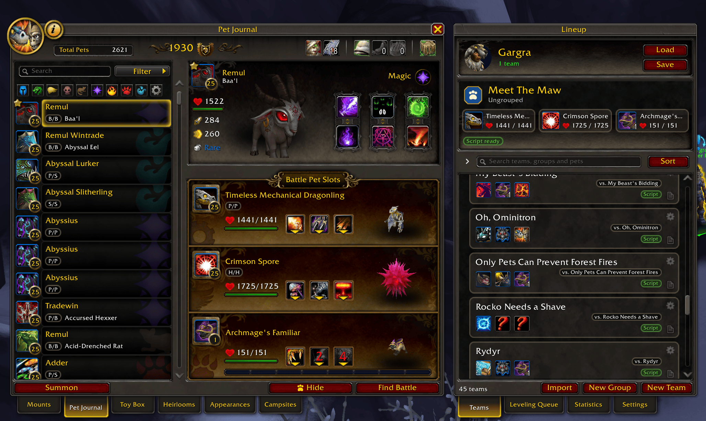

# Lineup

Lineup helps you save and load pet battle teams in World of Warcraft (Retail). It adds a window
next to Blizzard's Pet Journal. The journal itself works like before, with a few extra things
added.

## What it does

- **Teams:** save your three pets and their abilities as a team, and load it with one click.
- **Targets and notes:** give a team the tamer or wild pet it's for, and notes on how to win.
  Target that tamer and Lineup shows its teams. It can also load the team for you.
- **Groups:** sort your teams into groups, and search by team name, target or pet.
- **Leveling:** a team can take the next pet from your leveling queue, or a random level 25 pet.
- **Import:** paste teams from [Xu-Fu's Pet Guides](https://www.wow-petguide.com) and other sites,
  one or hundreds at once. Coming from Rematch? Import all your Rematch teams in one go.
- **Export:** share a team, a group or all your teams.
- **Scripts:** with [Pet Battle Scripts](https://www.curseforge.com/wow/addons/td-battle-pet-script)
  installed, a team's script runs from the Auto button in battle.
- **Statistics:** see how much of your collection you have, and how many pets are level 25 or
  rare.

## In the Pet Journal

- Filter pets by family with a row of icons above the list.
- More filters: strong or tough against a family, breed, level, duplicates and more.
- Each pet's breed (like P/S) shows below its name.
- Hide pets you never want to see: right-click a pet, then Hide.
- A toolbar with Revive Battle Pets, bandages, the Safari Hat, pet treats and a random favorite
  pet. Revive glows when one of your pets is hurt.

## How to use it

Open the Pet Journal (`Shift+P`, Pets tab) or type `/lineup`.

Lineup's settings are in Blizzard's Options, on the AddOns tab.

## Good to know

- Coming from a version before 1.9.0? Teams from older versions don't carry over. Export them with
  your old version first.

## Languages

English, German, French, Italian and Russian.

Is your language missing, or does a text read wrong? Let me know in an
[issue](https://github.com/remul/Lineup/issues). Help with translations is welcome.

## License

[MIT](LICENSE)
